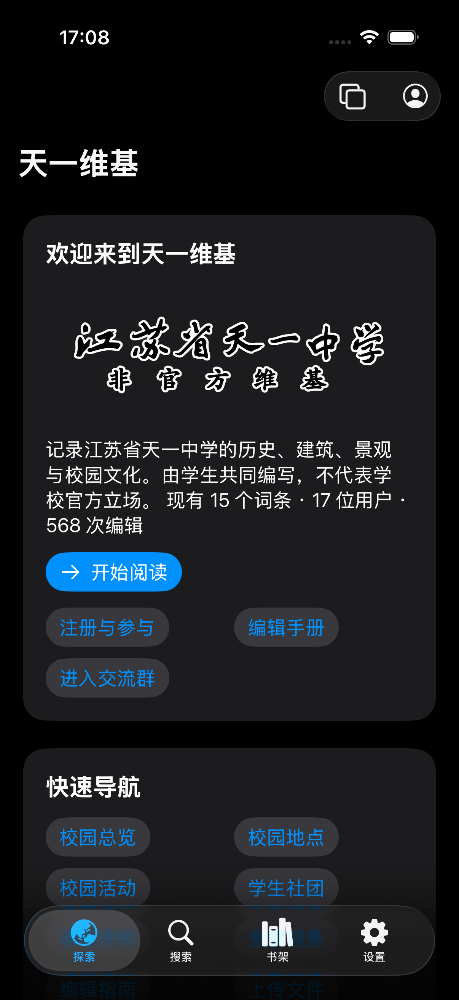
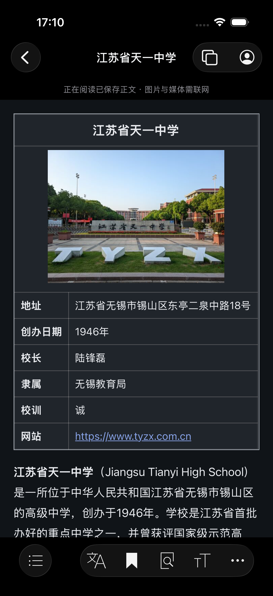
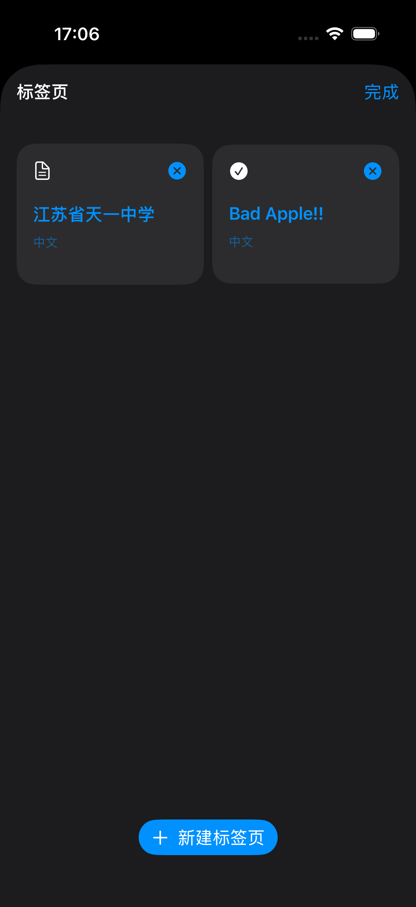

# Tianyi Wiki for iOS

[简体中文](README.md) | [English](README.en.md) | [Français](README.fr.md) | [日本語](README.ja.md) | [한국어](README.ko.md) | [文言](README.lzh.md)

An iPhone and iPad client for the **unofficial Jiangsu Tianyi High School wiki**. The community documents school history, campus places, clubs, events, and campus culture. This project does not represent the school and is not an official Wikimedia Foundation application.

This repository is a fork of [wikimedia/wikipedia-ios](https://github.com/wikimedia/wikipedia-ios). The Tianyi client reuses the upstream `WMFData` networking, request cancellation, and storage infrastructure, plus `WMFComponents` navigation controllers, fonts, and HTML snippet handling. It adds an adapter for Tianyi Wiki's standard MediaWiki API. Upstream copyright and license notices remain intact; the original README is preserved in [the upstream documentation archive](docs/upstream-wikipedia-ios.md).

<p></p>

## Native home and offline playback

The Chinese wiki home is rebuilt as native cards from a bundled snapshot, with the maintainer’s transparent wordmark and campus photos. Text and home images work on first offline launch; the snapshot updates with app releases. Recent changes refresh online and cache locally: only the newest change per title, up to five entries.

The reader toolbar is ported from upstream ArticleToolbarController and IconBarButtonItem, with the same icons and native UIToolbar. On iOS 26+, contents stand alone on the left; language, save, find, appearance and more form the trailing system glass group. Comments, sharing and revision history are in More. Dark styling includes captions, tables and necessary web fallbacks, which hide site notices and navigation. Articles and help pages favor local article layout.

Bad Apple!! uses AVPlayer with cached audio and app-controlled text animation driven by native playback time. The first visit downloads audio and frames and saves article HTML. Subsequent playback uses local files, without loading the original page. Linked images and external resources may still need a connection. Clearing offline articles also deletes these assets.

Comments retain the site’s authentication and permissions. Pages without a comment region show “Comments are disabled for this article”; discussion pages are not substituted. Comments need a connection. No live test comments were posted. Text spoilers support touch-to-reveal.

## Article tabs, accounts and live comments

Top controls now open article tabs and the account menu. Create, switch and close tabs; live reader state is retained while switching, and tab titles/history survive app restarts.

Registration, login and logout use Tianyi Wiki’s own forms inside the app, preserving privacy-policy consent, QQ verification and other server checks. New-window policy links open separately without losing the registration form. Signed-in users see their site username and actual avatar, with a system icon as fallback. User/talk pages, notifications, watchlist, avatar management and preferences remain website-backed.

The static article’s comments placeholder is replaced with “View comments”, opening the real comments panel. Web forms, comments and native API requests share the site session and its permissions. The maintainer personally verified login, the real avatar and the authenticated composer; no production comment or test account was created.

The app does not read or log passwords or QQ codes. Website/system cookie storage holds the session. Local account IDs and one-way session fingerprints separate authenticated and anonymous article caches; another account’s cached text is not reused.

<p></p>

## iPad layout

On iPadOS 18 and later, the home screen uses the system floating top tabs. Opening an article hides the tabs while keeping back navigation; returning home restores them. The reader supports both orientations, contents and language sheets, and a share popover. Larger text reflows the article, and Tianyi infoboxes and captions follow Dark Mode. Comment detection starts when the document is ready, without waiting for unrelated media.

Validated in simulators on iPad mini (A17 Pro), iPadOS 26.5 in Dark Mode, and 13-inch iPad Pro (M5), iPadOS 27 in Light Mode. See [validation notes](TianyiWiki/VALIDATION.md) for coverage and limits. Physical iPad testing remains outstanding.

## Wiki sites

| Language | URL |
| --- | --- |
| Chinese | https://zh-wiki.tyzx.org |
| English | https://en-wiki.tyzx.org |
| French | https://fr-wiki.tyzx.org |
| Japanese | https://ja-wiki.tyzx.org |
| Korean | https://ko-wiki.tyzx.org |
| Literary Chinese | https://lzh-wiki.tyzx.org |

The legacy `wiki.tyzx.org` host is also recognized as the Chinese site. Tianyi Wiki operates its own content and account services. Wikipedia accounts are not interchangeable with Tianyi accounts.

Article coverage differs between sites. Some existing interlanguage links point to pages that have not been created yet. The client reports missing pages and offers the selected wiki’s home page; it does not generate translations.

[Validation notes](TianyiWiki/VALIDATION.md) · [App Store](TianyiWiki/APP_STORE.md)

## Current implementation

- On iOS / iPadOS 26 and later, native navigation and tab bars adopt Liquid Glass and follow system appearance and accessibility settings. Article backgrounds prioritize reading; older systems retain compatible native styling.
- Native campus navigation, recent changes, random articles, and switching between six wiki sites.
- Search through the Action API, with debouncing, cancellation, and retry states.
- Article HTML from `action=parse`, with a table of contents, text scaling, sharing, and links to revision history. Article layout uses WebKit with page JavaScript disabled, without depending on Wikimedia's Page Content Service.
- Bookmarks save article HTML for offline reading. Images, audio, video, and external resources still require a connection. Saved articles may become outdated and can be refreshed or deleted.
- Local bookmarks, up to 200 history entries, and data-clearing controls.
- An app icon composed from the maintainer-supplied wordmark on an opaque white square, preserving the original lettering.

This is a development version and has not been published on the App Store. Login and registration now use in-app website flows; native editing has not been ported; category and special pages use the existing website for compatibility. Push notifications, Wikimedia recommendations, donations, Wikidata description editing, and cross-device sync are not integrated. The interface supports Simplified Chinese, English, French, Japanese, Korean, and Literary Chinese. Interface and wiki languages are selected independently. The article language menu opens existing interlanguage-linked versions; it does not automatically translate missing articles.

## Run the Tianyi client

Use an Xcode version supporting Swift 6.2 or newer. Development validation uses Xcode 27.2. The deployment target is iOS / iPadOS 17.

1. Clone this repository.
2. Open **`TianyiWiki.xcodeproj`** at the repository root and select the **`TianyiWiki`** scheme.
3. Allow Swift Package dependencies to resolve, then run on a simulator.
4. For a physical device, select your own Apple development team and adjust the `org.tyzx.TianyiWiki` bundle identifier as needed.

The original `Wikipedia.xcodeproj` remains the upstream project; it is not the Tianyi launch target.

```sh
xcodebuild -project TianyiWiki.xcodeproj -scheme TianyiWiki \
  -destination 'platform=iOS Simulator,name=iPhone 17 Pro,OS=26.4' \
  -derivedDataPath /tmp/tyzx-fork-build CODE_SIGNING_ALLOWED=NO build
```

Run `xcrun simctl list devices available` to find a suitable installed simulator. Upstream WMFComponents dependencies include SDWebImage and Rive; not every upstream feature is enabled in the Tianyi client.

## Source layout

- `TianyiWiki/App/`: application entry point, coordinator, screens, and article reader.
- `WMFData/Sources/WMFData/Data Controllers/Tianyi/`: API adapter, trusted hosts, persistence, and article cache.
- `TianyiWiki/Tests/`: application UI tests.
- `WMFData/Tests/WMFDataTests/WMFTianyiDataControllerTests.swift`: API, cache, and persistence tests.
- `TianyiWiki/Branding/`: original maintainer-supplied artwork.
- `TianyiWiki/Scripts/`: reproducible icon and Xcode project generation scripts.

## Privacy, content, and release

The Tianyi client does not initialize Wikimedia login, analytics, recommendations, or donation services. Anonymous reading requests go to Tianyi Wiki; page-linked images and other media may be served by additional providers. Bookmarks and history are stored locally. Website logs and third-party page behavior must still be considered when preparing privacy disclosures.

Article and media rights depend on each page's actual license and author history. The MIT code license does not grant rights to the school name, the supplied calligraphy, or Wikimedia trademarks. The maintainer must confirm the right to distribute the supplied artwork.

See the [App Store assessment](TianyiWiki/APP_STORE.md), currently in Simplified Chinese. Release work still includes content reporting and moderation, verified privacy and support pages, necessary account-management flows, signing, physical-device testing, and regional requirements. A successful fork or build does not imply App Store approval.

## License

Original Wikipedia iOS code retains its [MIT License](LICENSE.txt), copyright © 2013–2025 Wikimedia Foundation et al. New Tianyi source code is distributed under the same MIT terms. Brand artwork is not automatically licensed under MIT merely because it is present in this repository. Third-party dependencies retain their respective licenses.
