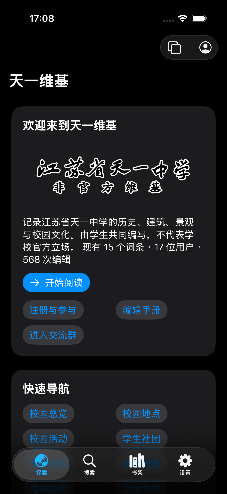
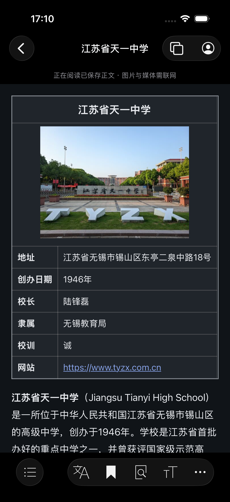
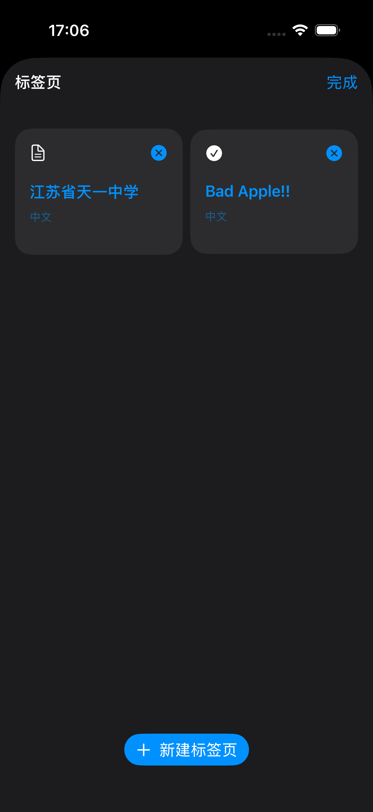
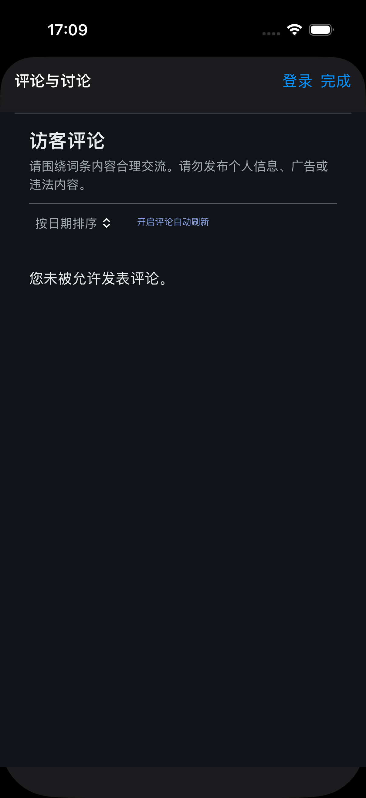
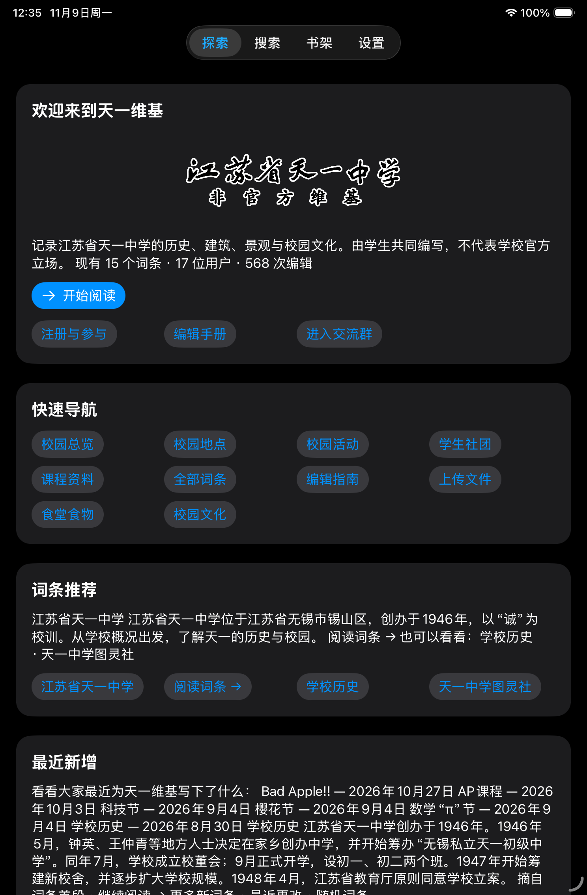
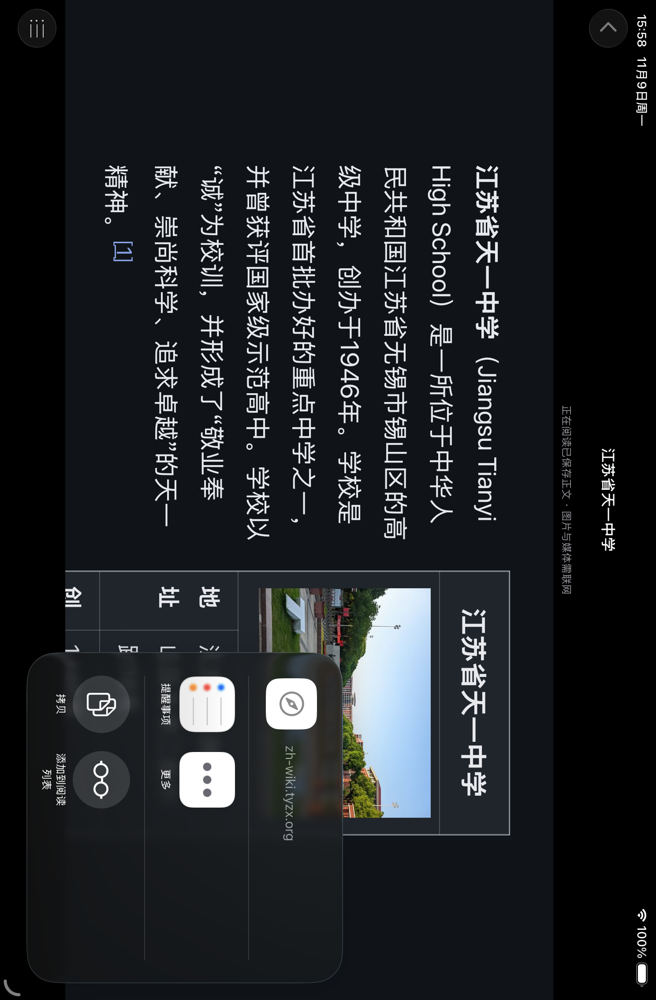

# 天一维基 iOS

[简体中文](README.md) | [English](README.en.md) | [Français](README.fr.md) | [日本語](README.ja.md) | [한국어](README.ko.md) | [文言](README.lzh.md)

江苏省天一中学非官方维基的 iPhone / iPad 客户端，记录学校历史、校园地点、社团、活动与校园文化。由社区共同编写，不代表学校官方立场，也不是 Wikimedia Foundation 的官方应用。

本仓库 fork 自 [wikimedia/wikipedia-ios](https://github.com/wikimedia/wikipedia-ios)。天一版复用上游 `WMFData` 的网络、取消请求与存储能力，以及 `WMFComponents` 的导航、字体和 HTML 摘要处理；另行适配天一维基的 MediaWiki API。上游许可证与作者声明保留，原始说明移至 [上游 README 存档](docs/upstream-wikipedia-ios.md)。

<p></p>

## 原生首页与离线播放

首页按中文站首页的真实栏目和内容重建为原生卡片，使用维护者提供的透明字标，保留校园照片及来源入口。文字与首页图片随应用内置，首次离线启动也可见；这是随版本更新的首页快照，不伪装为实时网页。最近更改联网刷新并在本机缓存，按标题仅保留最新记录，最多 5 条。

阅读底栏移植自上游 `ArticleToolbarController` 和 `IconBarButtonItem`：使用相同图标与原生 `UIToolbar`，iOS 26+ 将目录独立置于左侧，其余按钮组成右侧系统玻璃分组。词条语言、收藏、词条内查找、字号和更多保持上游顺序；评论、分享与修订历史位于“更多”。深色模式同时覆盖正文标题、图注、表格以及必要的站点兼容页面；兼容页面隐藏顶部公告和站点导航。普通词条和帮助页优先使用应用正文排版。

Bad Apple!! 改用 AVPlayer 播放本机音频，应用自带的正文动画逻辑按原生时间驱动黑幕。首次打开需联网下载音乐与帧数据，同时缓存词条正文，之后可从本机播放。远端原网页不参与播放；图片和外链仍不保证离线。清除离线收藏时也删除彩蛋素材。

阅读器提供评论入口，保留站点登录、权限和提交机制。页面无评论区域时显示“此词条关闭了评论功能”，不以讨论页冒充评论。评论需要联网；未在正式站点发送测试评论。普通黑幕支持触摸揭示。

## 标签页、账号与实际评论

顶部新增词条标签页与账号按钮。可新建、切换和关闭标签页；切换时保留当前阅读页面，重启后可恢复标签页列表及词条历史。

注册、登录和退出在应用内使用天一维基的原站表单，包括隐私政策确认、QQ 验证及服务器要求的其他校验。隐私政策等新窗口链接单独打开，保留原注册表单。登录后显示本站用户名与实际头像；未设置头像时使用系统用户图标。账号菜单提供用户页、讨论页、通知、监视列表、设置头像和账户设置。

正文中的“访客评论”改为“查看评论”入口，点击加载真实评论面板，避免静态正文一直显示 Loading comments。评论、账号网页和原生 API 共享本站会话，权限由服务器决定；没有评论区域的词条仍显示关闭提示。已由维护者亲自登录验证实际头像与评论输入框，未提交生产测试评论，也没有创建测试账号。

客户端不读取或记录密码及 QQ 验证码。登录 Cookie 由网站和系统网页存储管理；原生接口同步会话。本机保存账号 ID 与不可逆会话指纹用于隔离正文缓存；不同账号与匿名缓存分开，账号尚未确认时不借用其他账号正文。

<p></p>

## iPad 适配

iPadOS 18 及以上在首页使用系统顶部浮动标签栏，进入词条后收起标签栏并保留返回导航，返回首页时恢复。阅读器支持横竖屏、目录与语言面板及分享弹窗。放大字号会重新排版正文；天一自定义信息框与图注跟随深色模式。评论状态在正文就绪后检测，不再等待无关媒体加载。

已在 iPad mini（A17 Pro）/ iPadOS 26.5 深色模式与 13 英寸 iPad Pro（M5）/ iPadOS 27 浅色模式模拟器验证。范围与限制见[验证记录](TianyiWiki/VALIDATION.md)；尚未完成 iPad 真机验收。

<p></p>

## 当前站点

| 语言 | 地址 |
| --- | --- |
| 中文 | https://zh-wiki.tyzx.org |
| English | https://en-wiki.tyzx.org |
| Français | https://fr-wiki.tyzx.org |
| 日本語 | https://ja-wiki.tyzx.org |
| 한국어 | https://ko-wiki.tyzx.org |
| 文言 | https://lzh-wiki.tyzx.org |

中文旧域名 `wiki.tyzx.org` 仍识别为中文站。站点内容与账号服务由天一维基运营，不能使用维基百科账号代替。

各语言站点的条目覆盖不一致，部分现有跨语言链接的目标页面尚未创建。客户端会提示缺页并提供语言站首页入口，不自动生成或伪造译文。

[验证记录](TianyiWiki/VALIDATION.md) · [App Store](TianyiWiki/APP_STORE.md)

## 天一版功能

- iOS / iPadOS 26 及以上使用系统 Liquid Glass 导航和标签栏，随系统深色及辅助功能设置调整。正文保持适合阅读的背景；较早系统使用原生兼容样式。
- 六语言界面与六站独立选择；阅读器支持已有对应词条的跨语言切换。
- 原生校园导航、最近更改、随机词条及六站切换。
- 通过标准 Action API 搜索词条，提供防抖、请求取消及失败重试。
- 通过 `action=parse` 加载正文，提供目录跳转、字号调整、分享和修订历史入口。正文使用禁用网页 JavaScript 的 WebKit 排版，不依赖 Wikimedia Page Content Service。
- 收藏时保存正文，在本机离线阅读；图片、音视频和外链仍需联网。保存的正文可能落后于线上内容，可手动刷新或删除。
- 本机收藏、最多 200 条阅读历史，以及清除数据入口。
- 图标使用项目维护者提供的原始字标，居中放置在纯白方形画布上，没有重绘文字。

目前是开发版本，尚未上架 App Store。登录与注册已接入应用内网页流程，编辑尚未完成原生移植；分类和特殊页面使用站点网页作为兼容入口。推送、Wikimedia 推荐流、捐款、Wikidata 描述编辑及跨设备同步未接入天一版。用户界面支持简体中文、英语、法语、日语、韩语与文言；界面语言和站点语言独立选择。阅读器按现有跨语言链接切换对应词条，未建立对应版本的条目不会自动翻译。

## 运行天一版

需要支持 Swift 6.2 或以上的 Xcode，本次使用 Xcode 27.2。最低系统 iOS / iPadOS 17。

1. 克隆本仓库。
2. 打开根目录 **`TianyiWiki.xcodeproj`**，选择 **`TianyiWiki`** scheme。
3. 等待 Swift Package 依赖解析完成，选择模拟器运行。
4. 真机运行时选择自己的 Apple 开发团队，并按需调整 `org.tyzx.TianyiWiki` Bundle Identifier。

`Wikipedia.xcodeproj` 保留为上游原工程，不是天一版启动入口。

```sh
xcodebuild -project TianyiWiki.xcodeproj -scheme TianyiWiki \
  -destination 'platform=iOS Simulator,name=iPhone 17 Pro,OS=26.4' \
  -derivedDataPath /tmp/tyzx-fork-build CODE_SIGNING_ALLOWED=NO build
```

实际设备名称和系统版本可用 `xcrun simctl list devices available` 查询。依赖包括上游 WMFComponents 的 SDWebImage 与 Rive；这些依赖并不表示天一版使用了其所有功能。

## 源码位置

- `TianyiWiki/App/`：应用入口、协调器、界面及阅读器。
- `WMFData/Sources/WMFData/Data Controllers/Tianyi/`：天一 API、可信域名、持久化与正文缓存。
- `TianyiWiki/Tests/`：天一版 UI 测试。
- `WMFData/Tests/WMFDataTests/WMFTianyiDataControllerTests.swift`：接口、缓存及存储测试。
- `TianyiWiki/Branding/`：维护者提供的图标原图。
- `TianyiWiki/Scripts/`：图标及 Xcode 项目的重建脚本。

## 隐私、内容和发布

天一版不初始化 Wikimedia 登录、统计、推荐或捐款服务。匿名阅读请求会发送到天一维基，图片等资源可能由页面引用的其他服务提供。收藏及历史留在本机；不能据此把网站日志或第三方页面行为申报为“无数据收集”。

正文、媒体和历史作者的权利以各页面实际声明为准；代码 MIT 许可不替代内容许可，也不授予校名、校名字标或 Wikimedia 商标的使用权。维护者应确认所提供字标的发布权利。

App Store 发布评估见 [发布评估](TianyiWiki/APP_STORE.md)。当前仍需完成内容举报与处理流程、隐私及支持页面核验、所需账号管理能力、签名、真机测试和区域合规工作。代码可编译或 fork 成功不代表已经获准上架。

## 开源许可

原始 Wikipedia iOS 代码保留 [MIT License](LICENSE.txt)，版权 © 2013–2025 Wikimedia Foundation et al. 天一新增源码按相同 MIT 条款发布；提供的品牌图片不因放入此仓库而自动按 MIT 授权。第三方依赖按各自许可证使用。
